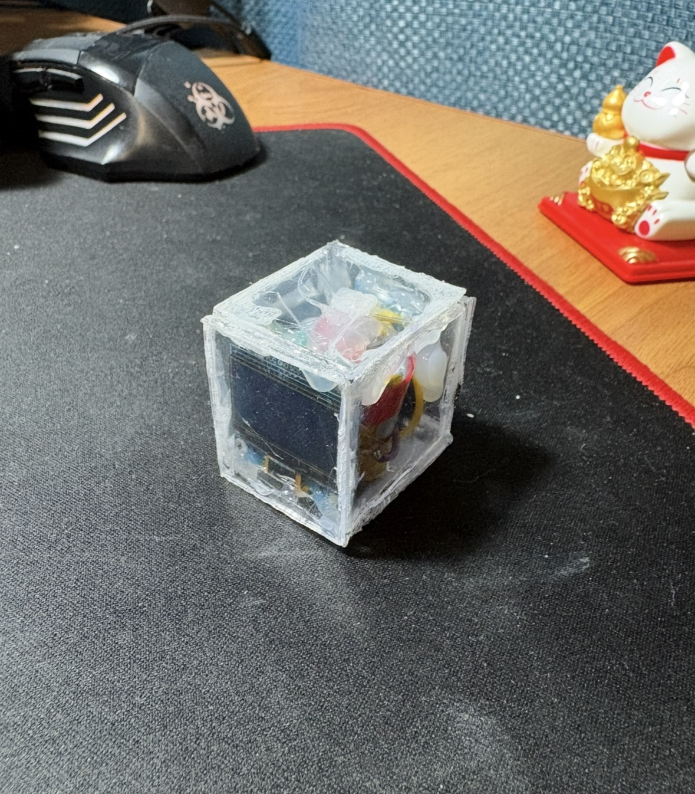
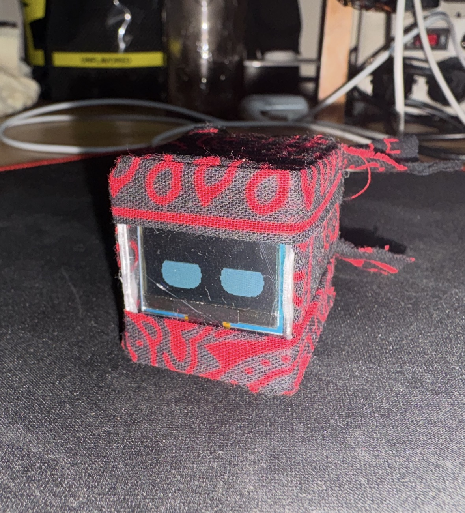
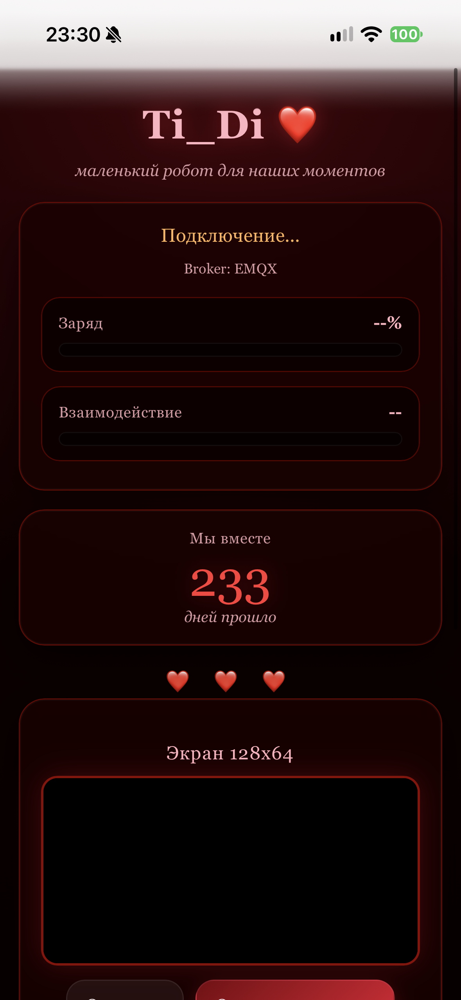
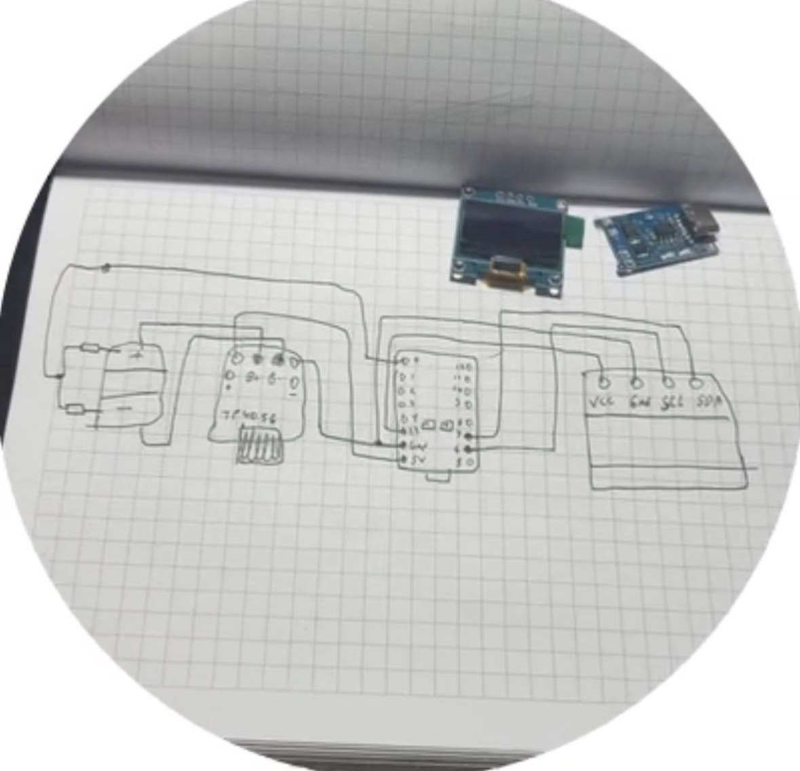
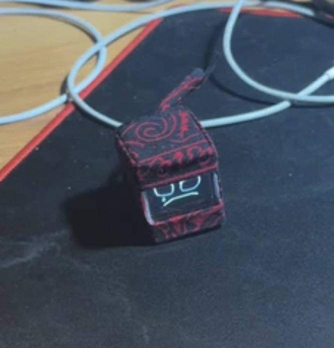

# Robot Eyes ❤

Мини-робот с выразительными глазами на **ESP32-C3 + OLED 128×64**, которым можно управлять **из любой точки мира** через веб-сайт.

Робот живёт своей жизнью: смотрит по сторонам, моргает, реагирует на «обнимашки» и «щекотку», скучает без внимания и показывает рисунки, отправленные с телефона.

<!-- ФОТО 1: робот целиком, общий вид (главное фото проекта) -->
<p align="center">
  
</p>

---

## Возможности

- 👀 **Живой взгляд** — глаза плавно двигаются синхронно, моргают и подмигивают
- 🫂 **Обнимашки** — тёплая анимация с прищуром, бровями и всплывающими сердечками
- 🤗 **Щекотка** — глаза дрожат и жмурятся, вокруг летят «искорки»
- 😢 **Авто-грусть** — если долго нет контакта, робот грустит и «плачет» каждые 30 секунд
- 😲 **Удивление** — проигрывается 2 секунды перед показом рисунка
- 🖼️ **Рисунок с сайта** — холст 128×64, отправляется на OLED и держится 60 секунд
- 🔋 **Шкала заряда** — уровень LiPo-батареи в реальном времени
- 💞 **Шкала взаимодействия** — насколько давно был контакт (растянута на 3 часа)
- 📅 **Счётчик дней** — сколько дней пара вместе (с 28 марта 2026)
- 📶 **Мульти-Wi-Fi** — робот сам выбирает самую сильную сеть из сохранённых
- 🌍 **Удалённое управление** — без белого IP, проброса портов и компьютера-посредника

<!-- ФОТО 2: крупный план дисплея с глазами -->
<p align="center">
  
</p>

---

## Стек

| Компонент | Технология |
|---|---|
| Микроконтроллер | ESP32-C3 Super Mini |
| Прошивка | MicroPython |
| Дисплей | OLED SSD1306 128×64 (I2C) |
| Транспорт | MQTT (`broker.emqx.io`) |
| Веб-клиент | HTML + CSS + JS + `mqtt.js` |
| Хостинг сайта | GitHub Pages |

---

## Архитектура

```text
Телефон / любой браузер
        ↓ HTTPS
GitHub Pages (index.html)
        ↓ MQTT over WebSocket (WSS)
   broker.emqx.io
        ↑ MQTT over TCP
   ESP32-C3 + OLED
```

ESP32 сам инициирует исходящее соединение к брокеру и подписывается на темы команд.
Сайт публикует сообщения в те же темы. Роутер настраивать не нужно.

<!-- ФОТО 3: скриншот веб-интерфейса на телефоне -->
<p align="center">
  
</p>

---

## Подключение

| OLED | ESP32-C3 |
|---|---|
| VCC | 3.3V |
| GND | GND |
| SDA | GPIO 7 |
| SCL | GPIO 6 |

Дополнительно:

- **BOOT-кнопка** — GPIO 9 (встроенная, запускает случайную эмоцию / отменяет рисунок)
- **Батарея** — GPIO 2 через делитель напряжения (по умолчанию 2:1)

<!-- ФОТО 4: начинка / схема подключения, вид на плату и провода -->
<p align="center">
  
</p>

---

## Структура проекта

```text
.
├── main.py            # прошивка ESP32-C3
├── index.html         # веб-интерфейс (GitHub Pages)
├── docs/
│   └── photos/        # фотографии проекта
└── README.md
```

---

## Установка

### 1. Прошивка

1. Прошить ESP32-C3 firmware **MicroPython**
2. Скопировать `main.py` в корень устройства
3. Указать свои Wi-Fi сети:

```python
WIFI_NETWORKS = (
    ("SSID_1", "password_1"),
    ("SSID_2", "password_2"),
)
```

> ESP32-C3 поддерживает только **2.4 GHz**.
> Для хотспота iPhone нужно включить «Режим совместимости / Maximize Compatibility».

### 2. Сайт

1. Залить `index.html` в репозиторий
2. `Settings → Pages → Deploy from a branch → main / root`
3. Убедиться, что `SECRET` совпадает в обоих файлах

```python
# main.py
SECRET = "your-long-random-secret"
```

```js
// index.html
const SECRET = "your-long-random-secret";
```

---

## Настройка поведения

Все параметры — в начале `main.py`.

### Батарея

```python
BATTERY_ENABLED  = True
BATTERY_ADC_PIN  = 2
BATTERY_DIVIDER  = 2.0     # 1.0, если без делителя
BATTERY_EMPTY_MV = 3300
BATTERY_FULL_MV  = 3800
```

### Скорость анимации

```python
LOOK_SPEED  = 3      # скорость движения глаз
BLINK_SPEED = 10     # скорость моргания
BLINK_HOLD  = 20     # пауза с закрытыми глазами, мс
LOOK_MIN    = 450    # как часто меняется направление
LOOK_MAX    = 1200
```

### Тайминги

```python
EMOTION_DURATION               = 3000    # длительность эмоции
SURPRISE_BEFORE_IMAGE_DURATION = 2000    # удивление перед рисунком
CUSTOM_IMAGE_DURATION          = 60000   # показ рисунка
BLINK_MIN = BLINK_MAX          = 30000   # моргание раз в 30 сек
IDLE_SAD_AFTER                 = 3 * 60 * 60 * 1000
AUTO_SAD_INTERVAL              = 30000
```

<!-- ФОТО 5: рисунок с сайта, отображённый на дисплее робота -->
<p align="center">
  
</p>

---

## MQTT-топики

| Топик | Направление |Payload |
|---|---|---|
| `robot-eyes/<SECRET>/cmd` | сайт → робот | `hug`, `tickle`, `sadness`, `surprise` |
| `robot-eyes/<SECRET>/image` | сайт → робот | base64, 1024 байта (128×64 mono) |
| `robot-eyes/<SECRET>/status` | робот → сайт | `online;battery=87;idle=42` |

Команды отправляются с **QoS 1** и подтверждаются `PUBACK`.

---

## Особенности реализации

- **Самописный MQTT-клиент** — без внешних библиотек, только `socket`
- **Фиксированный приёмный буфер** — защита от фрагментации heap
- **Ручной base64-декодер** — декодирует прямо в буфер OLED, без лишних аллокаций
- **Watchdog памяти и связи** — при критическом состоянии ESP32 перезагружается сама
- **Отключён Wi-Fi power save** — стабильное TCP-соединение
- **Мгновенный отклик** — новая команда прерывает текущую анимацию или рисунок
- **Рисунок грузится на OLED один раз** — I2C не забивается покадровой перерисовкой
- **Автоподбор частоты I2C** — 400 → 200 → 100 kHz
- **Деформация век** — глаза не просто масштабируются, а меняют форму, наклон и изгиб

---

## Безопасность

⚠️ Публичный брокер `broker.emqx.io` **не имеет авторизации**.
Единственная защита — длинный случайный `SECRET` в имени топика.

Рекомендации:

- не использовать простые значения вроде `12345678`
- не публиковать реальные пароли Wi-Fi и `SECRET` в открытом репозитории
- для постоянного использования поднять приватный брокер (Mosquitto на VPS) с логином, паролем и TLS

---

## Планы

- [ ] Приватный MQTT-брокер с TLS
- [ ]更多 эмоций и случайные «фоновые» действия
- [ ] Датчик касания для физических обнимашек
- [ ] Звуковые реакции
- [ ] Корпус для 3D-печати

---

## Лицензия

MIT
